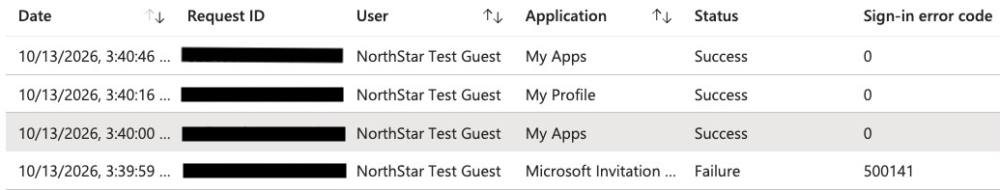

# Lab 11: Microsoft Entra ID Sign-in Monitoring and Incident Investigation

## Objective

Review Microsoft Entra ID sign-in logs to investigate a failed guest sign-in, correlate the event with the guest invitation state, and compare it with subsequent successful sign-ins.

## Environment

- Microsoft Entra ID
- NorthStar Technologies lab tenant
- NorthStar SSO Test enterprise application
- Microsoft Invitation Acceptance Portal
- My Apps
- My Profile
- Guest user configured through Microsoft Entra B2B collaboration

## Investigation Activities

### 1. Reviewed Successful Sign-ins

Inspected sign-in events for NorthStar SSO Test and Azure Portal. Both events showed a successful status. Authentication details indicated that the first-factor requirement was satisfied by a claim in the token. Security Defaults showed Success for both events.

Reviewed device information for the NorthStar SSO Test event. The device was reported as not compliant and not managed.

### 2. Investigated a Failed Guest Sign-in

Expanded the sign-in log date range to seven days and identified a failed event associated with the NorthStar Test Guest account.

Observed details:

- Application: Microsoft Invitation Acceptance Portal
- Status: Failure
- Error code: 500141
- Failure reason: The user's redemption is complete, but the request was not initiated by the target application.
- Authentication details: No authentication events were triggered as part of the authentication.
- Security Defaults: Success

### 3. Correlated the Event with Guest Account State

Reviewed the NorthStar Test Guest account in Microsoft Entra ID.

- User type: Guest
- User classification: External user under B2B collaboration
- Invitation state: Accepted

The accepted invitation state was consistent with the failure reason indicating that redemption had already completed.

### 4. Reviewed Subsequent Sign-in Activity

Observed three successful sign-in events after the failed event:

- My Apps
- My Profile
- My Apps

The first successful My Apps sign-in occurred one second after the failed invitation acceptance request. Its authentication details indicated that the first-factor requirement was satisfied by a claim in the token. Security Defaults showed Success.

The subsequent successful events demonstrated that the guest was able to sign in after the failed request.

## Findings

The failed sign-in was associated with a request-flow mismatch during guest invitation acceptance. The guest account's invitation state was Accepted, and three subsequent successful sign-ins were recorded.

The available evidence suggests that the failure did not prevent subsequent access. However, the exact root cause of error 500141 was not confirmed. The investigation did not establish that the activity was malicious or that Security Defaults caused the failure.

## Security and Privacy Considerations

- Reviewed authentication results, failure reasons, and sign-in timestamps.
- Correlated sign-in logs with the guest account's invitation state.
- Compared failed and successful events before drawing conclusions.
- Reviewed device management and compliance information.
- Avoided changing or removing the guest account without evidence justifying remediation.
- Redacted visible Request ID digits from the screenshot before preparing public portfolio evidence.

## Skills Demonstrated

- Microsoft Entra ID sign-in log analysis
- Authentication failure investigation
- Guest identity and B2B invitation state verification
- Correlation of sign-in events and timestamps
- Review of authentication details and Security Defaults
- Device compliance and management status review
- Evidence-based incident assessment
- Privacy-conscious documentation

## Outcome

Completed a sign-in investigation involving a failed guest invitation acceptance request and three subsequent successful sign-ins. Correlated the event with the guest's accepted invitation state and documented the findings while preserving uncertainty about the unconfirmed root cause.

## Evidence

